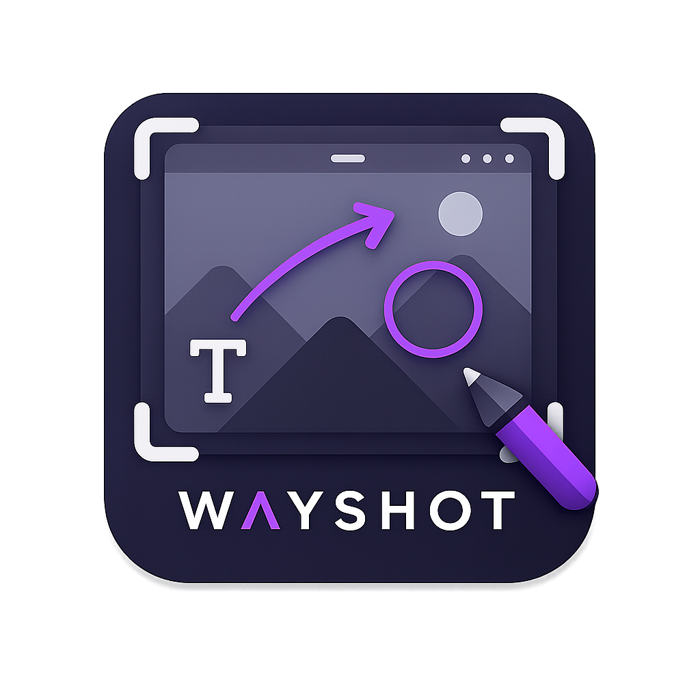

<p align="center">
  
  <br>
  <a href="https://flathub.org/apps/details/io.github.gutopardini.wayshot">
    
  </a>
</p>

# WayShot

WayShot is a fast screenshot and annotation tool for Linux, built around a clean GNOME/Wayland workflow.

It is designed for the common “capture, mark, copy, paste” loop:

1. Trigger a screenshot.
2. Annotate it quickly.
3. Press `Ctrl+C`.
4. Paste the final image into chat, issues, docs, or email.

## Features

- Screenshot capture through the XDG desktop portal.
- Capture-first helper command for GNOME/Wayland: `wayshot-gnome-capture`.
- Open images from disk.
- Paste images from the clipboard.
- Annotate with pen, rectangle, circle/ellipse, line, arrow, text, and blur/pixelate.
- Select and move annotations.
- Copy the rendered result to the clipboard.
- `Ctrl+C` copies through `wl-copy` and closes WayShot when the copy succeeds.
- Save the final image as PNG, JPEG, WebP, JPEG XL, AVIF, or TIFF when the
  corresponding runtime encoder is available and passes a save probe. JPEG XL
  uses `libjxl` when the runtime's GdkPixbuf loader is read-only.
- Resize text annotations from the settings popover.
- Glass-style editor UI with image backdrop.

## Native Install

Fedora dependencies:

```sh
sudo dnf install rust cargo gtk4-devel libadwaita-devel pkgconf-pkg-config gcc wl-clipboard
```

Ubuntu dependencies:

```sh
sudo apt update
sudo apt install rustc cargo libgtk-4-dev libadwaita-1-dev pkg-config gcc wl-clipboard
```

Build and install locally:

```sh
make install
```

Install the recommended GNOME shortcut:

```sh
make install-shortcut
```

The shortcut installer registers:

```text
Shortcut: Super+Shift+S
Command: ~/.local/bin/wayshot-gnome-capture
```

To choose another keybinding:

```sh
WAYSHOT_SHORTCUT='<Primary><Shift>s' make install-shortcut
```

This installs:

```text
~/.local/bin/wayshot
~/.local/bin/wayshot-gnome-capture
~/.local/share/applications/io.github.gutopardini.wayshot.desktop
~/.local/share/icons/hicolor/scalable/apps/io.github.gutopardini.wayshot.svg
~/.local/share/icons/hicolor/256x256/apps/io.github.gutopardini.wayshot.png
~/.local/share/icons/hicolor/512x512/apps/io.github.gutopardini.wayshot.png
~/.local/share/icons/hicolor/1024x1024/apps/io.github.gutopardini.wayshot.png
```

Make sure `~/.local/bin` is in your `PATH`.

## Usage

Capture and open the editor:

```sh
wayshot --capture
```

Open an existing image:

```sh
wayshot path/to/image.png
```

Run the app normally:

```sh
wayshot
```

`wayshot --help` lists the capture options. The outcome is chosen before the
screenshot UI appears, so each desktop shortcut can do one thing:

```sh
wayshot --clipboard
wayshot --path ~/Pictures
wayshot --path ~/Pictures --clipboard
wayshot --fullscreen --clipboard
wayshot --region --path ~/Pictures --format png
wayshot --raw
wayshot --delay 2 --fullscreen --path ~/Pictures
```

`--path` and `--clipboard` can be combined. They save and copy the capture,
then exit without opening the editor. With no output option, WayShot opens the
editor. Press Esc in the screenshot UI to cancel; WayShot stays closed.

Recommended GNOME shortcut, if you prefer setting it manually:

```text
Command: wayshot --capture
Shortcut: Super+Shift+S
```

## Editor Workflow

- Use the floating toolbar to choose an annotation tool.
- Use the color palette to change annotation color.
- Use settings to change stroke size and zoom.
- Use settings to change text size and the output image format. Text size also
  updates the selected text annotation.
- Press `Ctrl+C` to copy the rendered image and close the window.
- Use the copy button if you want to copy without closing the app.
- Use save to export in the selected format.

WayShot keeps interactive portal capture on desktops that support it. On
compositors such as niri, where the portal cannot provide interactive capture,
it automatically falls back to a full-screen capture.

## Build

Run from source:

```sh
cargo run
```

Build release:

```sh
cargo build --release --locked
```

Validate formatting and compile tests:

```sh
cargo fmt -- --check
cargo test
```

## Flatpak

WayShot is available on Flathub:

```sh
flatpak install flathub io.github.gutopardini.wayshot
```

### Manual GNOME Shortcut (Flatpak)

When installed via Flatpak, you need to register the keyboard shortcut in your
desktop environment to maintain the quick capture workflow.
Use `wayshot --capture`, or `WAYSHOT_CAPTURE=1` for an existing shortcut. The
screenshot portal is requested before the editor window is built, and pressing
Esc in the screenshot UI closes WayShot without showing it.

#### Automated Install (Recommended)

Run this command to automatically set up the `Super+Shift+S` shortcut:

```sh
curl -sSL https://raw.githubusercontent.com/gutopardini/wayshot/main/scripts/install-flatpak-shortcut | bash
```

#### Manual Setup

If you prefer to do it manually:

1. Open **Settings** -> **Keyboard** -> **Keyboard Shortcuts** -> **View and Customize Shortcuts**.
2. Scroll down and select **Custom Shortcuts**.
3. Click **Add Shortcut** (+).
4. Fill in the details:
   - **Name**: `WayShot`
   - **Command**: `flatpak run io.github.gutopardini.wayshot --capture`
   - **Shortcut**: `Super+Shift+S` (or your preferred keybinding)
5. Click **Add**.

Flatpak still has to start its sandbox, especially on a cold start. After the process is running, WayShot requests the screenshot portal before it builds the editor, so the selector is not waiting on the window.

### Development & Build

The Flatpak manifest lives at:

```text
flatpak/io.github.gutopardini.wayshot.yml
```

Generate vendored Cargo sources before building a Flatpak:

```sh
flatpak-cargo-generator Cargo.lock -o flatpak/cargo-sources.json
```

Build and install locally:

```sh
flatpak-builder --force-clean --install-deps-from=flathub --user --install build-flatpak flatpak/io.github.gutopardini.wayshot.yml
```

## Support

<a href="https://www.buymeacoffee.com/gutopardini" target="_blank">
  
</a>
